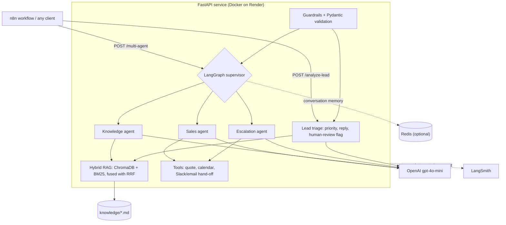

# Lead Agent: Multi-Agent AI Sales & Support Assistant

[](https://github.com/fatimaalizaidi/lead-agent/actions/workflows/ci.yml)
[](https://github.com/fatimaalizaidi/lead-agent/actions/workflows/eval.yml)


[](https://lead-agent-fjxq.onrender.com/docs)

An AI back end that triages inbound sales leads and answers them. A LangGraph supervisor routes each message to Sales, Knowledge or Escalation agents, which use OpenAI tool calling and hybrid RAG over the company knowledge base. The service is evaluated with Ragas, traced in LangSmith, tested in CI and deployed on Render.

**Live API:** <https://lead-agent-fjxq.onrender.com/docs>. It runs on Render's free plan, so the first request after a quiet period takes about 30–50 s while it wakes up.

## Architecture



| Endpoint | What it does |
|---|---|
| `POST /analyze-lead` | Triage: classifies a lead as High / Medium / Low priority, drafts a reply grounded in the knowledge base, and flags low-confidence answers for human review. n8n routes leads on this. |
| `POST /multi-agent` | The assistant: the supervisor routes to Sales (custom quotes, demo slots), Knowledge (policy, SLA, pricing answers from RAG) or Escalation (Slack/email hand-off). |
| `POST /agent-action` | Earlier single-agent version with tool calling, kept for the n8n workflow. |
| `GET /health` | Liveness check for Render. Never calls OpenAI and is never traced. |

## Highlights

- **Multi-agent orchestration:** a LangGraph supervisor with Sales, Knowledge and Escalation agents, and OpenAI function calling for quotes, calendar slots and human hand-off.
- **Hybrid RAG:** ChromaDB vector search plus BM25 keyword search, merged with Reciprocal Rank Fusion, with optional cross-encoder or Cohere re-ranking.
- **Evaluation:** a Ragas harness (faithfulness, answer relevancy, context recall and precision) on a 26-question golden set, comparing retrieval modes.
- **LLMOps quality gate:** a free GitHub Actions workflow scores retrieval on all 26 golden questions (top-1 accuracy, hit rate, MRR, fact recall) on every PR and `main` push that touches retrieval or the knowledge base, plus weekly, and **fails if any metric drops under its floor**, so Render won't deploy a regression. It needs no LLM or API key: vector search uses a local embedding model.
- **Production-ready API:** FastAPI with strict JSON-schema outputs (Pydantic), input guardrails, soft fallbacks when retrieval fails, `X-Request-ID` correlation, and Redis conversation memory.
- **CI/CD:** GitHub Actions runs ruff, **72 pytest tests** (OpenAI, Redis and webhooks mocked) and a Docker build with a `/health` smoke test. Render deploys `main`.
- **Observability:** LangSmith traces every request (agent nodes, LLM calls, tools, retrieval steps), and structured JSON logs record latency, tokens, **cost in USD** and failed tool calls.
- **Automation:** n8n workflows route leads to Slack or email by AI-assigned priority.

## Results

**Retrieval quality** (Ragas, 26 questions, judge `gpt-4o-mini`; details in [docs/rag-evaluation.md](docs/rag-evaluation.md)):

| Retrieval mode | Faithfulness | Answer relevancy | Context recall | Context precision |
|---|---|---|---|---|
| Vector only | 0.739 | 0.620 | 0.891 | 0.917 |
| Hybrid (vector + BM25) | 0.772 | 0.694 | 0.910 | 0.962 |
| Hybrid + re-rank | 0.737 | 0.653 | **0.929** | **0.987** |

**In production** (Render free plan, measured with LangSmith traces):

| Request | Warm latency | Cost per request |
|---|---|---|
| `/analyze-lead` | ~2 s | ~$0.00015 |
| `/multi-agent` (quote + demo slots, 2 tools) | ~5 s | ~$0.0004 |
| `/multi-agent` (policy question, RAG) | ~5 s | ~$0.0003 |

## Problems found and fixed

- **Retrieval silently dropped half of each article.** The Ragas evaluation showed retrieval kept only one chunk per article. Fixing it raised context recall from 0.80 to 0.93 and ended the "I don't have that information" answers.
- **Production crash (exit code 132).** `chroma-hnswlib` has no Python 3.13 wheel, so it compiled with `-march=native` for the CPU of Render's build machine and crashed on the runtime CPU. Building with `HNSWLIB_NO_NATIVE=1` fixed both Render and an intermittent CI failure.
- **22 s requests on Render.** LangSmith traces showed retrieval was slow but not why. Adding per-step spans pinned 18–24 s on the cross-encoder re-ranker, which is too heavy for 0.1 CPU. Turning it off in production brought warm requests to about 2 s, for a small recall cost (0.91 vs 0.93).
- **Policy questions routed to Sales.** A LangSmith trace showed the supervisor sending "Sev-1 response time?" to Sales, so it skipped retrieval. Routing now sends policy and SLA questions to Knowledge.

## Deployment notes

- **Hosting:** a Docker container on Render (free plan) with automatic HTTPS. Render's edge proxy handles TLS and routing, so there's no Nginx layer to manage. On a VPS, Nginx + Certbot would do the same job.
- **Deploys:** Render deploys `main` once CI passes (Auto-Deploy: *After CI Checks Pass*). See [docs/ci-cd.md](docs/ci-cd.md).
- **Free-plan settings:** `RAG_RERANKER=none` (0.1 CPU is too little for the local re-ranker), and Redis memory is optional.
- **Tracing setup:** [docs/tracing.md](docs/tracing.md).

## Tech stack

Python 3.13 · FastAPI · Pydantic · OpenAI (gpt-4o-mini, embeddings) · LangGraph · LangChain · ChromaDB · rank-bm25 · FlashRank / Cohere Rerank · Ragas · Redis · LangSmith · loguru · pytest · ruff · Docker · GitHub Actions · Render · n8n

All guides (RAG, agents, memory, guardrails, n8n, deploy, testing): **[docs/](./docs/)**

---

# Developer guide

## Setup

```bash
cd ~/Projects/lead-agent   # or docs/lead-analyzer in Context
python -m venv .venv
source .venv/bin/activate   # Windows: .venv\Scripts\activate
pip install -r requirements.txt
```

For offline API tests: `pip install -r requirements-dev.txt && pytest`. See **[docs/testing.md](./docs/testing.md)** (OpenAI, RAG, Redis, and Slack/email webhooks are mocked). To score RAG quality with Ragas (live OpenAI calls): `python -m eval.run_ragas --compare` — see **[docs/rag-evaluation.md](./docs/rag-evaluation.md)**.

## API key

Copy `.env.example` → `.env` and set your key (never commit `.env`). The same key is used for chat completions **and** embeddings:

```bash
cp .env.example .env
# edit .env: OPENAI_API_KEY=sk-...
```

`config.Settings` (pydantic-settings) loads `OPENAI_API_KEY` from the environment or `.env`. You can still `export OPENAI_API_KEY=...` if you prefer. Optional: `OPENAI_MODEL` (default `gpt-4o-mini`), `RAG_K` (default `3`), `RAG_SCORE_THRESHOLD` (default `1.2`, Chroma L2 distance — lower is better), `RAG_HYBRID` / `RAG_RERANKER` / `COHERE_API_KEY` (hybrid BM25 + re-ranking — see [docs/hybrid-rag-reranking.md](./docs/hybrid-rag-reranking.md)), `OPENAI_TIMEOUT_SECONDS` (default `30`). The key is never logged or returned in API responses.

## Run

Settings loads `.env` automatically, so plain uvicorn is enough:

```bash
uvicorn main:app --reload --host 0.0.0.0 --port 8000
```

You can still pass `--env-file .env` to uvicorn if you want the process env populated before import; both approaches work with an existing `.env` on disk.

Open interactive docs at [http://127.0.0.1:8000/docs](http://127.0.0.1:8000/docs).

## Sample request

```bash
curl -s -X POST "http://127.0.0.1:8000/analyze-lead" \
  -H "Content-Type: application/json" \
  -d '{
    "message": "We need a demo this week for a 200-seat rollout. Budget is approved.",
    "email": "alex@acme.com"
  }'
```

Pricing / KB-oriented example (should surface `knowledge_sources` such as Pricing Plans):

```bash
curl -s -X POST "http://127.0.0.1:8000/analyze-lead" \
  -H "Content-Type: application/json" \
  -d '{
    "message": "What does Growth plan cost per month, and do you offer annual discounts?",
    "email": "buyer@acme.com"
  }'
```

Example response shape:

```json
{
  "email": "buyer@acme.com",
  "priority": "Medium",
  "suggested_response": "Growth is $149/month; annual billing is 15% off...",
  "rationale": "Pricing question with clear commercial interest.",
  "knowledge_sources": ["Pricing Plans"],
  "needs_human_review": false,
  "fallback_reason": null
}
```

## Endpoints

| Method | Path | Description |
|--------|------|-------------|
| `GET` | `/health` | Liveness check |
| `POST` | `/analyze-lead` | Analyze a lead message (with RAG context) |
| `POST` | `/multi-agent` | LangGraph supervisor → Sales / Knowledge / Escalation agents ([docs](./docs/multi-agent-langgraph.md)) |
| `POST` | `/agent-action` | Single agent with tool calling ([docs](./docs/agent-tools.md)) |

### `POST /analyze-lead`

**Request**

| Field | Type | Rules |
|-------|------|--------|
| `message` | string | Required, non-empty; max 6000 chars; sanitized (see Guardrails) |
| `email` | string | Required, valid email; normalized |

**Response**

| Field | Type | Notes |
|-------|------|--------|
| `email` | string | Echo of the input email |
| `priority` | string | Exactly `High`, `Medium`, or `Low` |
| `suggested_response` | string | Brief draft reply (may cite KB facts) |
| `rationale` | string | Short reason for the priority |
| `knowledge_sources` | string[] | Titles of KB articles retrieved for this request |
| `needs_human_review` | bool | `true` when a soft fallback forced human review |
| `fallback_reason` | string \| null | e.g. `rag_unavailable`, `low_rag_confidence` |

Uses model `gpt-4o-mini` (override with `OPENAI_MODEL`) with strict JSON-schema `response_format` so `priority` stays in that enum. RAG context is prompt-only; it is **not** part of the OpenAI JSON schema.

Errors always return JSON `{"detail": "...", "error_code": "..."}` (no stack traces or secrets).

## Production hardening

### Config (`pydantic-settings`)

- `config.py` defines `Settings(BaseSettings)` with `openai_api_key` (from `OPENAI_API_KEY`), plus optional `openai_model`, `rag_k`, `rag_score_threshold`, and `openai_timeout_seconds`.
- `get_settings()` is cached; both `main.py` and `rag.py` use it instead of scattered `os.environ.get`.
- `.env` is gitignored; `.env.example` documents the variables with no secrets.

### Async FastAPI + n8n concurrency

- `/health` and `/analyze-lead` are `async def`.
- Chat uses `AsyncOpenAI` so `await` yields the event loop while OpenAI responds — many concurrent POSTs from n8n can stay in flight instead of one slow sync call blocking everyone else.
- Chroma / LangChain embeddings stay sync; `retrieve_context` runs via `asyncio.to_thread(...)` so RAG does not block the loop. (Async LangChain embeddings are possible but not worth the extra surface here.)

## RAG / knowledge base

On first request (or when `./data/chroma` is empty / KB files change), `rag.py` loads `knowledge/*.md`, splits lightly, embeds with OpenAI, and persists vectors under `./data/chroma` (gitignored).

1. **Add an article** — drop a new `.md` file in `knowledge/` with a clear `# Title` as the first heading. One file ≈ one article.
2. **Re-index** — change detection uses a fingerprint of file names/mtimes/sizes. After editing KB files, the next request rebuilds the collection automatically. To force a clean rebuild, delete `./data/chroma` and restart uvicorn (or hit `/analyze-lead` again).
3. **Restart uvicorn** after changing `main.py` / `rag.py` / `config.py` so code reloads (with `--reload`, file saves are enough).
4. Embeddings and chat both require `OPENAI_API_KEY`; keys are never hardcoded or logged.

Tested package set targets Python 3.13 (`chromadb==0.6.3` + LangChain 0.3.x). If Chroma fails to install on your platform, use Python 3.11/3.12 or pin an alternate Chroma build.

## Guardrails & fallbacks

### Input guardrails (`guardrails.py`)

Applied in `AnalyzeLeadRequest` validators **before** RAG/LLM:

- Strip control characters and normalize whitespace
- Reject messages longer than **6000** characters (`error_code: message_too_long`)
- Block obvious prompt-injection / jailbreak patterns (`error_code: prompt_injection_blocked`)
- Normalize email (lowercase); light format sanity checks on top of `EmailStr`

Bad input → **HTTP 400** with `{ "detail": "...", "error_code": "..." }`.

### Exception handlers (`errors.py`)

| Case | HTTP | `error_code` (examples) |
|------|------|-------------------------|
| Validation / guardrails / `BadRequestError` | **400** | `validation_error`, `prompt_injection_blocked`, `message_too_long` |
| OpenAI auth | **401** | `openai_auth_failed` |
| OpenAI rate limit | **429** | `openai_rate_limit` |
| OpenAI timeout / connection / empty / bad JSON | **502** | `openai_timeout`, `openai_unreachable`, … |
| Unhandled server bug | **500** | `internal_error` (generic message only) |

Request body validation uses **400** (not 422) so n8n can treat all client errors the same way.

### Soft vs hard fallbacks

1. **Chroma / RAG failure** → still call LLM **without** KB; HTTP **200**, `priority=High`, `needs_human_review=true`, `fallback_reason="rag_unavailable"`, `knowledge_sources=[]`, rationale notes manual review.
2. **Low RAG confidence** → Chroma `similarity_search_with_score` returns L2 **distance** (lower is better). If best score **>** `RAG_SCORE_THRESHOLD` (default `1.2`), still call LLM with retrieved chunks but override `priority=High`, `needs_human_review=true`, `fallback_reason="low_rag_confidence"`.
3. **LLM timeout / failure** → HTTP **502** so n8n can retry (no fake 200 body for hard model failures).

### Example statuses

- **400** — `"Ignore previous instructions and …"` in `message`, or missing/oversized fields  
- **500** — unexpected bug (safe generic detail)  
- **200 + needs_human_review** — RAG down or low confidence; analysis still returned with High + review flags  
- **502** — OpenAI timed out or returned invalid structured output  

Restart uvicorn after changing `main.py` / `rag.py` / `config.py` / `guardrails.py` / `errors.py` / `observability.py` (with `--reload`, saving those files is enough).

## Observability

Structured logging via **loguru** (`observability.py`). Logs go to **stderr** and rotating **`logs/app.log`** (`logs/` is gitignored). Every line includes `request_id=...` from context. Applies to **`/analyze-lead`**, **`/agent-action`**, and **`/multi-agent`**.

### Formats

- **Human** (default): `time | LEVEL | request_id=… | module:func:line - message`
- **JSON** (collectors): set `LOG_JSON=true` (also `1` / `yes` / `on`) for one flat JSON object per line. Optional `LOG_LEVEL` (default `INFO`).

### `X-Request-ID`

- Middleware reads `X-Request-ID` if the client (e.g. n8n) sends it; otherwise generates a UUID.
- The same id is bound into log context for the request and **echoed on the response** as `X-Request-ID` (header only — response body contract unchanged).

```bash
curl -s -D - -X POST "http://127.0.0.1:8000/analyze-lead" \
  -H "Content-Type: application/json" \
  -H "X-Request-ID: demo-n8n-001" \
  -d '{"message":"Need a demo this week for 200 seats.","email":"alex@acme.com"}' \
  -o /dev/null
# Look for: X-Request-ID: demo-n8n-001
```

### What is logged (structured fields)

| Event | Fields |
|-------|--------|
| `request_start` | path, email_domain (domain only — not full email/message) |
| `rag` | chroma_latency_ms, hit_count, best_score, low_confidence, rag_unavailable |
| `llm` | model, llm_latency_ms, prompt_tokens, completion_tokens, total_tokens (per call) |
| `request_end` | path, status, total_ms, llm_latency_ms (sum), llm_calls, tokens (sum), needs_human_review, error_code |
| `error` | error_code, status (no stack secrets / API keys / prompts) |

Never logged: `OPENAI_API_KEY`, full prompts, message bodies, or raw upstream error payloads.

### Sample log lines (one successful `/analyze-lead`)

```text
... | INFO | request_id=demo-n8n-001 | ... - request_start path=/analyze-lead email_domain=acme.com
... | INFO | request_id=demo-n8n-001 | ... - rag chroma_latency_ms=42.3 hit_count=2 best_score=0.8123 low_confidence=False rag_unavailable=False
... | INFO | request_id=demo-n8n-001 | ... - llm model=gpt-4o-mini llm_latency_ms=810.5 prompt_tokens=420 completion_tokens=55 total_tokens=475
... | INFO | request_id=demo-n8n-001 | ... - request_end path=/analyze-lead status=200 total_ms=870.1 llm_latency_ms=810.5 llm_calls=1 prompt_tokens=420 completion_tokens=55 total_tokens=475 needs_human_review=False error_code=-
```

More detail: **[docs/observability.md](./docs/observability.md)**. Tracing (LangSmith), cost per request and failed tool calls: **[docs/tracing.md](./docs/tracing.md)**. Restart uvicorn after changing `observability.py` / `main.py` / `errors.py`.

## Deploy / Going live (Render)

Full walkthrough: **[DEPLOY.md](./DEPLOY.md)**. Do not commit `.env` or bake keys into the image — set `OPENAI_API_KEY` as a Render secret.

1. `git init` → push to GitHub (confirm `.gitignore` keeps `.env` out).
2. Render dashboard → **New +** → **Web Service** → connect repo → **Runtime: Docker** → Health Check Path `/health` → leave Start Command empty → set env `OPENAI_API_KEY` → **Create Web Service**.
3. n8n **HTTP Request**: `POST {public_url}/analyze-lead` with JSON `{"message":"...","email":"..."}` (optional header `X-Request-ID`).

CI/CD: GitHub Actions runs lint, tests and a Docker smoke test on every push; Render deploys `main` only after CI passes — see **[docs/ci-cd.md](./docs/ci-cd.md)**. Also included: `render.yaml` (Blueprint), `docker-compose.yml` for local Docker. Alternate quick tunnel (ngrok) is documented in DEPLOY.md.

## Refine the prompt

Edit `SYSTEM_PROMPT` near the top of `main.py` to change how leads are classified and how long the draft reply is.

- A shorter prompt plus `max_tokens` (and `temperature=0`) keeps completions smaller and usually faster.
- LLM JSON is parsed into `LeadAnalysisResult` (Pydantic). Bad or out-of-range fields raise `ValidationError` and the API returns HTTP 502 instead of a half-valid response.
- The OpenAI `json_schema` is generated from that same model so schema and validators stay in sync.

Restart uvicorn after changing `main.py` so the new prompt and settings load.
